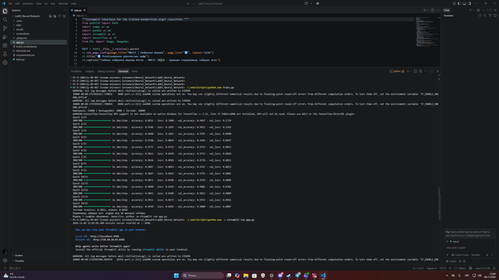
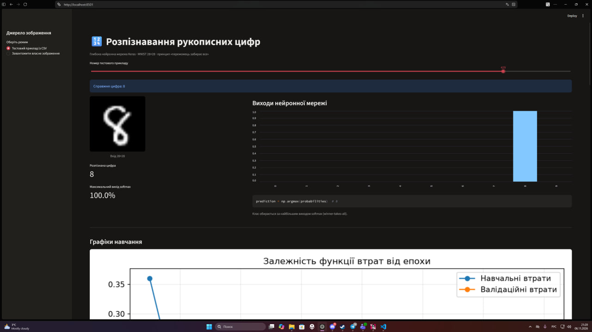
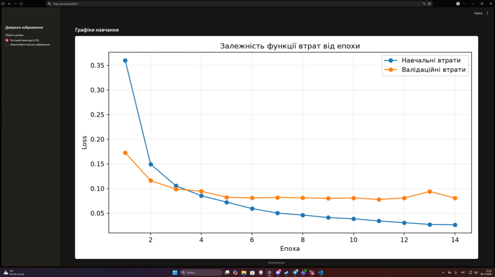
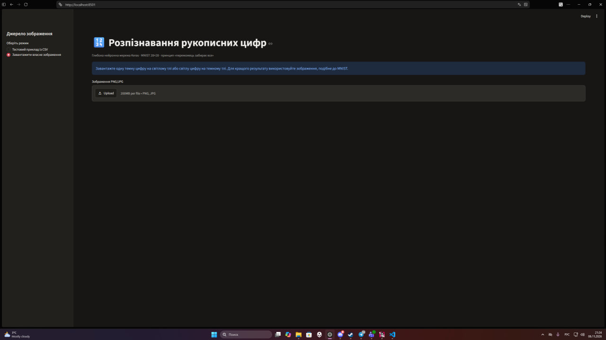
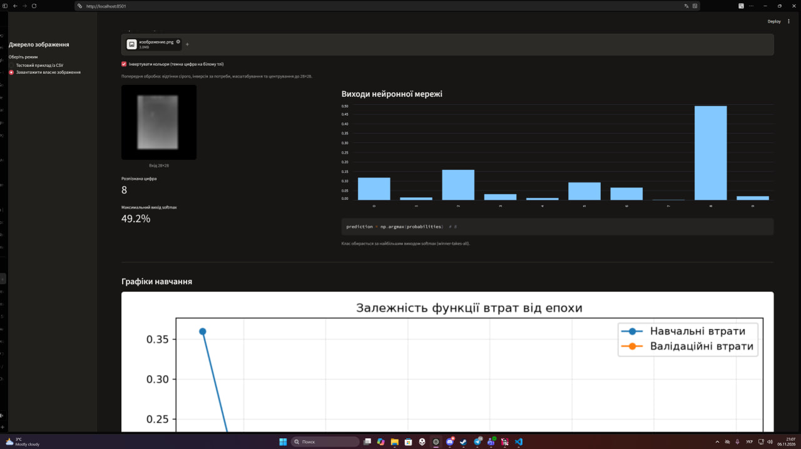

# Лабораторна робота №3 — Штучні нейронні мережі

## Розпізнавання рукописних цифр за допомогою Keras

Навчальний проєкт із дисципліни **«Основи штучного інтелекту»**. Програма навчає глибоку нейронну мережу розпізнавати рукописні цифри від **0 до 9** за зображеннями розміром **28 × 28 пікселів**, а також надає вебінтерфейс для перевірки результатів.

## Мета роботи

Розробити й навчити нейронну мережу для класифікації рукописних цифр, застосувати принцип **«переможець забирає все»** та дослідити зміну функції втрат на навчальних і валідаційних даних залежно від епохи.

## Використані технології

- **Python** — мова програмування.
- **TensorFlow / Keras** — створення, навчання й оцінювання нейронної мережі.
- **NumPy, Pandas** — обробка числових даних із CSV.
- **Matplotlib** — побудова графіків навчання.
- **Streamlit** — вебінтерфейс для розпізнавання цифр.
- **Pillow** — обробка завантажених зображень.

## Вхідні дані

Використовуються файли з архіву `Lab03.zip`:

- `data/mnist_train.csv` — навчальні дані;
- `data/mnist_test.csv` — тестові дані.

Кожен рядок містить мітку класу (цифру від 0 до 9) і **784 значення яскравості пікселів**. Зображення має розмір **28 × 28**, значення пікселів нормалізуються перед поданням у мережу.

## Принцип роботи

1. Програма зчитує навчальні й тестові CSV-файли.
2. Підготовлені зображення надходять до глибокої нейронної мережі з прихованими шарами.
3. Під час навчання мережа коригує параметри для зменшення помилок класифікації.
4. Вихідний шар **Softmax** формує оцінки ймовірностей для 10 класів.
5. Функція **`argmax`** вибирає клас із найбільшим виходом — реалізація принципу **«переможець забирає все»**.
6. Результати навчання та графіки зберігаються для аналізу.

## Результати експерименту

За результатами виконаного навчання отримано:

| Показник | Значення |
|---|---:|
| Точність на тестових даних | **98,12 %** |
| Значення тестової функції втрат | **0,0658** |
| Виконано епох навчання | **14** |
| Кількість класів | **10** |
| Розмір вхідного зображення | **28 × 28** |

> Результати стосуються конкретного запуску навчання й можуть дещо відрізнятися під час повторних запусків.

## Запуск проєкту у Visual Studio Code

Рекомендована версія — **Python 3.12**.

1. Відкрийте папку проєкту у VS Code.
2. Розпакуйте файли `mnist_train.csv` і `mnist_test.csv` з наданого викладачем архіву в папку `data`.
3. Створіть віртуальне середовище (Windows PowerShell):

   ```powershell
   py -3.12 -m venv .venv
   ```

4. Встановіть залежності:

   ```powershell
   .\.venv\Scripts\python.exe -m pip install -r requirements.txt
   ```

5. Запустіть навчання:

   ```powershell
   .\.venv\Scripts\python.exe train.py
   ```

6. Після завершення навчання запустіть вебінтерфейс:

   ```powershell
   .\.venv\Scripts\python.exe -m streamlit run app.py
   ```

7. Відкрийте в браузері **http://localhost:8501**.

У вебінтерфейсі можна вибрати приклад із тестового CSV або завантажити власне зображення цифри. Для власного зображення передбачено попередню обробку до формату **28 × 28**. За потреби використовуйте перемикач інверсії кольорів відповідно до фону зображення.

## Скріншоти виконання лабораторної роботи

### 1. Навчання нейронної мережі у Visual Studio Code

Процес навчання, значення точності та функції втрат у терміналі.



### 2. Графік функції втрат

Залежність навчальних і валідаційних втрат від кількості епох.



### 3. Розпізнавання цифри з тестових даних

Приклад класифікації цифри із тестового набору MNIST.



### 4. Загальний вигляд вебінтерфейсу Streamlit

Інтерфейс із вибором джерела зображення, результатом прогнозування та діаграмою виходів нейронної мережі.



### 5. Завантаження власного зображення рукописної цифри

Вибір режиму завантаження власного файлу та відображення зображення після попередньої обробки.


### 6. Реакція нейронної мережі на власне зображення

Результат класифікації завантаженої цифри: визначений клас, найбільший вихід Softmax і діаграма оцінок для всіх десяти класів.



> Щоб зображення відображалися на GitHub, додайте до репозиторію папку `screenshots` із файлами **`01.jpg`**, **`02.jpg`**, **`03.jpg`**, **`04.jpg`**, **`05.jpg`**, **`06.jpg`**. Назви та розширення мають точно збігатися з посиланнями вище.

## Висновок

У ході лабораторної роботи було створено та навчено глибоку нейронну мережу для розпізнавання рукописних цифр від 0 до 9 з використанням бібліотеки Keras. Для навчання й тестування використано зображення розміром 28 × 28 пікселів, представлені у форматі CSV.

Модель досягла **98,12 % точності на тестових даних** за значення функції втрат **0,0658**. Вихідний шар Softmax разом із вибором максимального значення через `argmax` реалізує принцип «переможець забирає все». Побудовані графіки дозволяють проаналізувати перебіг навчання та валідації.

Додатково реалізовано вебінтерфейс Streamlit, у якому можна перевіряти тестові приклади й завантажувати власні зображення. Якість розпізнавання власних фотографій залежить від контрастності, масштабу, розташування цифри та відповідності зображення навчальним даним.

**Мету лабораторної роботи досягнуто.**

## Примітки для GitHub

Не завантажуйте до репозиторію віртуальне середовище `.venv`, кеші Python або конфіденційні дані. Великі навчальні CSV-файли за потреби можна отримати з архіву, наданого викладачем.
